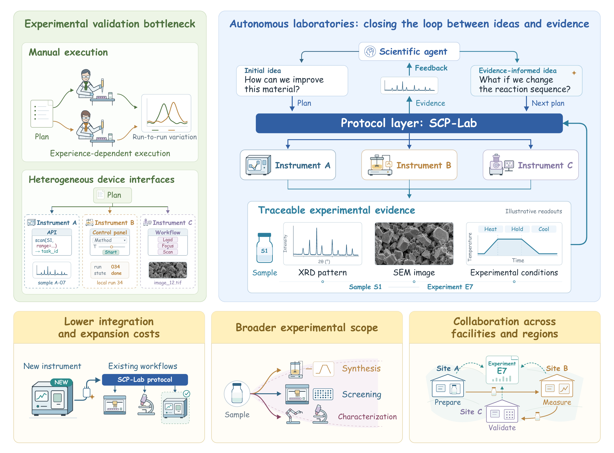
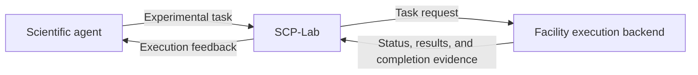

# SCP-Lab

**Discover laboratory capabilities, submit tasks, and interpret execution feedback through a shared interface.**

[简体中文](README.zh-CN.md) · [User guide](docs/README.md) · [Design](docs/design.md) · [Protocol reference](docs/device-access.md)

SCP-Lab is an extension of the [Science Context Protocol (SCP)](https://github.com/InternScience/scp) for autonomous laboratories. It defines a shared interface for describing and invoking facility capabilities: facilities specify their supported operations, accepted parameters, and how they report execution status and results. Scientific agents discover experimental capabilities and submit tasks through SCP-Lab. Execution backends at each facility control devices or integrated workstations to carry out experimental operations and return execution status and experimental results to the agents through SCP-Lab. Agents use this feedback to refine their experimental plans, closing the loop between computational planning and physical experimentation.



## How it works

The scientific agent, SCP-Lab, and facility backend have distinct responsibilities:

| Role | Responsibility |
| --- | --- |
| Scientific agent | Develop experimental plans, discover facility capabilities and initiate tasks, analyze feedback, and refine subsequent experiments |
| SCP-Lab | Unify device and capability registration and discovery, standardize capability descriptions and control scope, and provide interfaces for task submission, status, results, and completion evidence |
| Facility execution backend | Check requests and local execution conditions, control devices or integrated workstations to carry out experimental operations, and return execution status, results, and completion evidence |



When registering a device, integrators specify its capabilities, including supported operations, parameters, and completion criteria, and associate an execution backend. Agents discover and inspect these capabilities through SCP-Lab to understand which operations a facility can perform and which parameters they can adjust. They use this information to select suitable facilities, design experiments, and submit tasks. During execution, the backend returns status, results, and completion evidence through SCP-Lab so the agent can evaluate the findings and refine subsequent plans.

SCP-Lab uses five access levels, L1–L5, to describe the control a facility exposes, from complete workflows to actuator actions. This helps agents choose between reusing established procedures and organizing finer operations according to experimental needs, while giving facilities with different control granularity a consistent way to integrate. Integrators can choose task granularity and orchestration arrangements accordingly.

SCP-Lab provides an MCP-compatible interface so existing MCP clients can access facility capabilities. See the [design guide](docs/design.md) for details of access levels, execution feedback, and MCP compatibility.

## Installation

Have Git and [uv](https://docs.astral.sh/uv/getting-started/installation/) available, then run:

```bash
git clone https://github.com/InternRobotics/SCP-Lab.git scp-lab
cd scp-lab
uv sync --frozen --python 3.12 --extra mcp
```

This installs SCP-Lab and its MCP dependencies in `.venv`. If you already have the source, run only the last command from the repository root. See the [installation guide](docs/installation.md) for environment setup, verification, and troubleshooting.

After installation, choose a tutorial or go directly to an integration guide.

## Tutorials

| Tutorial | What you will explore |
| --- | --- |
| [Introduction: your first device call](docs/getting-started.md) | Discover a demonstration device, submit a task, and understand execution feedback |
| [Advanced: OT-2 simulation](docs/ot2-examples.md) | Generate code from a pipetting request, run it in the official simulator, and inspect the result |

## Integration guides

| Your goal | Guide | What you will build |
| --- | --- | --- |
| Call devices from an application or agent | [Application integration](docs/clients.md) | An MCP connection that discovers capabilities, submits requests, and reads outcomes |
| Register device instances | [Device configuration](docs/backends.md#configure-devices-with-an-existing-backend) | One saved configuration per instance, using an existing adapter |
| Wrap an SDK or laboratory service | [Backend development](docs/backends.md#develop-an-adapter-for-a-new-sdk-or-api) | A reusable adapter that provides capability definitions and returns execution feedback |

## Device interfaces and examples

| Content | Purpose |
| --- | --- |
| Device-access API over local MCP stdio | Discovery, capability inspection, submission, polling, state queries, and cancellation where supported |
| Offline interface catalog | Request validation for 45 device models and 89 action definitions |
| OT-2 backend | Code generation and official simulation, with a separately installed simulator |
| Mock devices and adapter template | Examples for client integration, execution lifecycle, and multiple device instances |

The [model definitions](src/scp_lab/adapters/README.md) are independent files organized by device family. Their instance configurations make them callable through MCP; the same files provide examples for [publishing a new device interface](docs/backends.md#add-a-model-for-offline-validation).

Bundled backends run in software. Connecting physical equipment requires a hardware adapter.

## Explore further

- [User guide](docs/README.md): tutorials, integration instructions, and reference pages.
- [Examples](examples/README.md): device calls, multi-device sequences, lifecycle handling, and custom backends.
- [Protocol reference](docs/device-access.md) and [JSON Schemas](schemas/README.md): messages, units, defaults, lifecycle, and evidence.
- [Contributing](CONTRIBUTING.md): development setup and checks.
