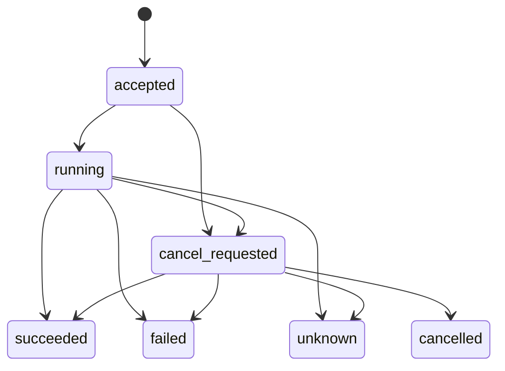

# SCP-Lab device access v0.1

[简体中文](zh-CN/device-access.md) · [Documentation](README.md) · [Home](../README.md) · [Client integration](clients.md) · [Device integration](backends.md) · [JSON Schemas](../schemas/README.md)

This reference explains v0.1 requests, responses, field meanings, and how this repository's runtime handles requests. The current server accepts calls through local MCP stdio. The caller handles experiment planning and sequences of operations.

See the [client guide](clients.md) for connection and invocation steps, and the [backend guide](backends.md) for device configuration, capability definitions, and SDK integration.

## Identity and capabilities

Callers first discover device instances, then query the capabilities each instance offers. These identifiers distinguish the model, instance, implementation, and requested operation:

| Field | Meaning |
| --- | --- |
| `model_id` | The device model |
| `device_id` | A locally configured device instance, used to select the device in a request |
| `backend_id` | The backend implementation that handles requests for the instance |
| `capability_id` | A capability offered by the instance, used to select the operation in a request |

Instances of the same model can use different backends and offer different capabilities. Read the actual instance's description through `describe_device(device_id)` before calling it.

Each returned capability includes `capability_id`, `version`, `description`, `input_schema`, `result_schema`, and `completion_criteria`. The two schemas define the input and successful result formats; `completion_criteria` describes the conditions for completion. Capability schemas use JSON Schema Draft 2020-12.

An instance's `execution_mode` states how it handles calls: offline validation, mock, official simulation, or hardware execution. Instances do not have to progress through these modes in order. The caller selects an instance through `device_id` and uses its declared mode. Input formats, result formats, and completion conditions can differ between modes, so follow the capability definitions returned by that instance. See the [backend guide](backends.md#validation-and-execution-stages) for the modes and [completion evidence](#completion-evidence) for interpreting results.

A capability can also declare `access_level` to describe the control it exposes to the caller; see the [five access levels](design.md#five-levels-of-exposed-control). Bundled device functions are primarily L3; the OT-2 `delay` helper has no declared access level. The level follows the published interface. A multi-device client's call sequence and the commands generated inside a backend do not change the capability's declared level.

<a id="three-core-objects"></a>
## Device descriptions, states, and execution records

| Data | Tools that return it | Main contents |
| --- | --- | --- |
| `DeviceDescriptor` | `describe_device` | Device identifiers, provider, execution mode, capabilities and versions, input/result schemas, optional state schema, and cancellation support |
| `DeviceState` | `get_device_state` | Backend availability, local occupancy, the associated run, and optional observations with timestamps and sources |
| `ExecutionRecord` | `submit_execution`, `get_execution`, `cancel_execution` | A request, its effective arguments and versions, execution status, progress, result, error, and completion evidence |

The `list_devices` response contains descriptor summaries with a state snapshot nested under each item's `state`. Thus, `item.state.state` in that list corresponds to `DeviceState.state` in a separate state query.

Device-specific fields are defined by `input_schema`, `result_schema`, and `state_schema`. Backends declare the operations they support and the data they can report. Observations such as temperature, speed, or sample location can be omitted when unavailable.

### Revisions

The `descriptor_revision` is a SHA-256 content identifier computed from the static description, capability schemas, versions, and declared configuration version. Availability and occupancy changes do not change it. This repository's runtime fixes descriptions at startup; restart the server after changing capability declarations or static configuration.

A backend can declare `configuration_version`; credentials stay in local configuration. Each execution records the `descriptor_revision` and `capability_version` it used, so callers can check the interface on which the request was based.

A request can include `expected_descriptor_revision`. If it differs from the current revision, the server returns `descriptor_changed` before execution and the caller should query the description again. Omitting it uses the current revision. The revision checks the interface definition; device calibration and readiness require device feedback.

### Optional fields

| Data | Field | Default or meaning when omitted |
| --- | --- | --- |
| Device description | `provider`, `configuration_version` | `null`: not declared |
| Device description | `state_schema` | `null`: no schema declared for observation values |
| Device description | `cancellation_supported` | `false`: cancellation support is not declared |
| Capability | `access_level` | `null`: access level not declared |
| Capability | `defaults_policy` | `not_applied`: schema defaults are not inserted automatically |
| Capability | `result_schema` | `{"type":"object"}`; backends can declare a more specific successful result format |
| Capability | `limitations` | Empty list: no limitations listed; integrators should still document known limitations |
| Device state | `observation` | `null`: no observation currently available |
| Execution record | `progress`, `result` | Empty objects until populated |

Device and capability identifiers, input schemas, and execution modes must be explicit. Each capability's `required` list determines mandatory experimental parameters. That capability also declares its operating limits and defaults.

## MCP tools and messages

| Tool | Input | Successful `data` |
| --- | --- | --- |
| `list_devices` | Optional `device_class` | Instance summaries with nested state snapshots |
| `describe_device` | `device_id` | `DeviceDescriptor` |
| `get_device_state` | `device_id` | `DeviceState` |
| `submit_execution` | `request` | An accepted execution record, including `run_id` |
| `get_execution` | `run_id` | The execution's latest record |
| `cancel_execution` | `run_id` | The execution record after requesting cancellation |

### Response format

Common device tools return responses in MCP `structuredContent` and equivalent JSON text, with their format declared through `outputSchema`:

| Situation | MCP `isError` | Response contents |
| --- | --- | --- |
| Tool call succeeds | `false` | `{"ok":true,"data":...}` |
| Tool call is rejected | `true` | `{"ok":false,"error":{"code":...,"message":...,"details":{...}}}` |
| Query successfully retrieves a failed or unresolved execution | `false` | `ok=true`; the execution's status and error are in `data.status` and `data.error` |

After calling `get_execution`, read the execution's `status` to determine its outcome. See [errors and schemas](#errors-and-schemas) for error codes and where they appear.

Invalid MCP argument shapes or unexpected server errors can produce responses directly from the MCP SDK, with a different format from the table above. The `call()` helper in the [client examples](clients.md) extracts `data` on success and raises an exception when the tool call fails.

### Request format and example

The `submit_execution` tool accepts a `request` with required fields `device_id`, `capability_id`, and `arguments`. The optional `expected_descriptor_revision` checks the descriptor revision; `idempotency_key` supports [retrying the same request](#idempotency-and-session-scope).

The `arguments` field is the complete object described by the selected capability's `input_schema`. That schema determines field names, nesting, required fields, and whether extra fields are allowed. Inputs use standard JSON; NaN and Infinity are rejected.

The following complete tool arguments use a centrifuge's offline-validation instance. This capability uses `parameters` for operation settings and `bindings` for sample references:

```json
{
  "request": {
    "device_id": "agilent_centrifuge_773-validation",
    "capability_id": "agilent_centrifuge_773.centrifugation",
    "arguments": {
      "parameters": {
        "speed": 1000,
        "duration": 30,
        "acceleration_percent": 100,
        "deceleration_percent": 100
      },
      "bindings": {"sample": {"resource_id": "sample-plate"}}
    },
    "idempotency_key": "my-centrifugation-1"
  }
}
```

This capability specifies speed in rpm and duration in seconds. Its `bindings.sample.resource_id` is a sample reference agreed between the caller and local backend. The offline backend checks the reference structure. For hardware integration, verify resources and positions against local device and sample configuration. Whether references include `position`, `sample_id`, or arrays also depends on the target capability's schema.

Other capabilities can use different argument structures. For example, `ot2-sim` uses `setup + liquids + parameters`, while the [plate reader adapter example](backends.md#develop-an-adapter-for-a-new-sdk-or-api) uses `plate_id + wavelength_nm`.

## Units and defaults

### Fixed units

Backends use `x-scp-unit` on numeric schema fields to declare units. The same convention applies to inputs, results, and state observations. For example, an object's `properties` can contain:

```json
{
  "volume": {
    "type": "number",
    "exclusiveMinimum": 0,
    "maximum": 1000,
    "x-scp-unit": "uL"
  }
}
```

Submit `{"volume":50}` to mean 50 uL; bounds and defaults use that unit too. Supply `"50 uL"` or `{"value":50,"unit":"uL"}` only if the capability's schema accepts that form. For arrays, annotate the numeric `items` schema.

The `x-scp-unit` annotation describes the unit. JSON Schema validators check declared types and constraints without converting values. Common project conventions include `uL`, `mL`, `L`, `s`, `min`, `degC`, `nm`, `mm`, `rpm`, `%`, `ppm`, and `mbar`; the reader example uses `AU` for absorbance. Devices can also use other documented units.

An absent annotation means the unit is undeclared, not dimensionless. Callers should confirm units from the target capability's schema, and integrators should document units for the fields they use. Counts can be explained by field names and descriptions; use `1` to declare a dimensionless unit explicitly. Some bundled shaking parameters and focal-height fields have undeclared units; confirm their conventions before using them.

### Multiple units

Devices supporting multiple units can define inputs such as `{"volume":{"value":0.05,"unit":"mL"}}`, declaring allowed units and appropriate bounds in their schemas. The backend implements any necessary conversions. Converting rotational speed to relative centrifugal acceleration also requires device geometry, which should be considered during integration.

### Parameter defaults

A capability's `defaults_policy` states how schema `default` annotations are handled:

| Policy | Behavior | Bundled examples |
| --- | --- | --- |
| `not_applied` | Default policy: pass arguments as supplied; `default` is descriptive | Offline-validation instances |
| `backend_resolved` | The backend fills published optional defaults through `resolve_arguments()`, then validates the effective arguments again | Demonstration heater and OT-2 backend |

Under both policies, fields listed in `required` must be supplied explicitly. Declaring a `default` does not make a required field optional.

For the demonstration heater in the [client guide](clients.md), omitting the optional `duration_s` makes the backend fill in one second. Execution record excerpt:

```json
{
  "request": {"arguments": {"target_celsius": 37}},
  "effective_arguments": {"target_celsius": 37, "duration_s": 1}
}
```

The `request.arguments` field preserves the original input; `effective_arguments` contains the arguments passed to `execute()`. Report actual device feedback, such as measured temperature, through results or observations, separately from requested settings.

<a id="dynamic-state-and-sources"></a>
## Device state and observations

The `DeviceState.state` field describes a device instance's availability and occupancy in the current server. The `ExecutionRecord.status` field describes one execution.

| Device `state` | Meaning |
| --- | --- |
| `idle` | The backend is available and no unreleased execution occupies the instance |
| `busy` | An execution is accepted or running, including while cancellation confirmation is pending |
| `unavailable` | No execution occupies the instance, but the backend is unavailable |
| `needs_attention` | An execution has a final status but has not released occupancy; verification and recovery are needed |

The `available` field separately reports backend availability. The base backend returns `true` by default, meaning the software implementation is available; hardware readiness requires device feedback. The `reported_at` field is the state snapshot's generation time. The fields `source="local_execution_runtime"` and `scope="this_server_process"` indicate that the current server process records this state.

Backends can supply device observations in `observation`:

| Field | Meaning |
| --- | --- |
| `values` | Observation values defined by the device's `state_schema` |
| `observed_at` | Original observation time, retained when cached data is queried again |
| `source` | Data source, such as a device SDK or simulator |
| `kind` | Data kind: `measured`, `device_reported`, `simulated`, or `declared` |

Publishing observations requires a declared `state_schema`, which the runtime uses to validate `values`. Return `observation=null` when no observation is available. Requested settings and actual readings should use distinct fields with clear meanings.

State queries only read availability and cached observations. Occupancy is established when a request is accepted; necessary execution conditions still need to be checked during request validation and execution.

## Execution lifecycle and occupancy

On submission, the runtime checks the request and local availability, then accepts the execution and reserves the instance. Each instance can have at most one unreleased execution. Conflicts return `device_busy` without queuing. Different instances can execute concurrently.

Execution statuses change as follows:



The `accepted` status means the request passed validation and was registered. Use the returned `run_id` to query subsequent status. The `succeeded` status means the call succeeded; its mode, result, and [completion evidence](#completion-evidence) explain what completed. Successful results are validated against `result_schema`.

### Cancellation

Cancellation can be requested when the device description declares `cancellation_supported=true`. Continue querying after `cancel_requested`. The backend returns `cancelled` only after confirming that the operation stopped. If the operation finishes concurrently, it can return `succeeded` instead. The final status can also be `failed` or `unknown`; handle the reported outcome.

The current OT-2 simulation implementation does not support cancellation. Interrupting the server process does not establish that hardware stopped; verify this through device feedback.

### Uncertain outcomes and device release

A backend returns `unknown` when it cannot establish the outcome. Unhandled hardware-backend exceptions also become `unknown`. The device stays in `needs_attention`, and the runtime does not retry automatically.

After an execution ends, the backend uses `BackendResult.device_released` to indicate whether its reservation can be released:

- Hardware backends explicitly return `device_released=true` after confirming that the device can accept another operation. Successful, failed, and cancelled executions all need separate release confirmation.
- Software backends default to releasing occupancy on known final outcomes and can explicitly retain it.
- The `unknown` status always retains occupancy. The final execution record stores the actual `device_released` value.

The current runtime has no interface for manually clearing unreleased occupancy. Hardware integrations should provide verification and recovery methods in their control software or backend.

The `updated_at` field changes when execution status or progress changes; querying does not change it. The `finished_at` field records when the local execution coroutine ends. Device feedback is still needed to confirm that a physical operation stopped.

## Completion evidence

A capability's `completion_criteria` declares the conditions for completion. The execution record's `completion_evidence` stores the evidence supplied by that call. Interpret results together with `execution_mode` and the capability's `result_schema`:

| `execution_mode` | Example `completion_evidence.kind` | Meaning of success |
| --- | --- | --- |
| `schema_validation` | `schema_validation` | The request passed the published input schema |
| `mock` | `mock_trace` | The demonstration software flow completed |
| `official_simulation` | `official_simulator_runlog` | Official software simulation completed |
| `hardware` | For example, `device_observation` | Actual feedback supports the capability's declared completion conditions |

The first three `kind` values come from bundled backends; the hardware row is an implementation example. Custom backends should document the meaning of their evidence. Keep the backend, result format, and completion conditions consistent. Detailed evidence can be placed in `completion_evidence.details`.

The `physical_execution=true` flag identifies a hardware execution path. A backend can set `completion_evidence.physical_completion_verified=true` only when actual feedback sufficiently supports completion. The runtime rejects this claim from nonhardware backends. All bundled backends run in software.

<a id="idempotency-and-session-scope"></a>
## Duplicate submissions and server scope

Provide an optional `idempotency_key` to retry the same request, for example when a submission receives no response. The key applies to one `device_id` within one server process:

| Submission | Behavior |
| --- | --- |
| Retry the same request with the original key | Return the existing execution and its `run_id` |
| Submit a different request with the original key | Return `idempotency_conflict` |
| Use a new key or omit the key | Handle it as a new request, subject to argument and occupancy checks |

Request comparison ignores object key order; other content is compared as JSON. Values that become equal after unit conversion are not treated as the same request. Preserve the original request contents when retrying.

Execution records, occupancy, and deduplication records stay in the current server's memory. Keep the same MCP session for submission and querying. After the server exits or restarts, old `run_id` values cannot be queried and old keys cannot prevent duplicate execution. Independently started servers track occupancy separately, so one server should manage a given physical device. Verify actual device and experiment state before deciding to execute again.

The current version has no durable queue, reconnection recovery, cross-process lock, event stream, or global sample ledger. Integrators can implement these features when needed. Simulation JSON files saved separately by OT-2-specific tools are not common execution records.

## Errors and schemas

When a tool call is rejected, its response contains `error`. Errors occurring after acceptance appear in the execution record's `error`. Both contain `code`, `message`, and `details`.

| Error code | Common cause | Location |
| --- | --- | --- |
| `unknown_device`, `unknown_capability` | The device is not registered or does not offer the selected capability | Tool response |
| `invalid_arguments` | Arguments do not meet capability requirements | Tool response |
| `backend_unavailable`, `device_busy` | The backend is unavailable or an unreleased execution still occupies the instance | Tool response |
| `descriptor_changed` | The requested descriptor revision differs from the current revision | Tool response |
| `idempotency_conflict` | The same key was used for a different request | Tool response |
| `unknown_run` | The current server has no record of this execution | Tool response |
| `cancellation_unsupported` | The backend does not declare support for cancelling an active execution | Tool response |
| `invalid_backend_state`, `invalid_backend_defaults` | Backend state or default-argument handling does not match its declarations | Tool response |
| `backend_error`, `simulation_failed`, `execution_interrupted` | Backend exception, simulation failure, or local execution interruption | Execution record |

Backends can add documented error codes. See the [JSON Schema directory](../schemas/README.md) for public message schemas and their MCP resource paths.

### OT-2-specific tools

The [OT-2-specific helper tools](ot2-examples.md#ot-2-specific-tools) directly return validation data, code, or simulation records in their own formats, without the common device tools' `ok/data` envelope.

These calls do not go through `submit_execution`, reserve a device instance, or produce a common execution record queryable through `get_execution`. The `simulate_protocol` tool returns after simulation finishes. Use its `run_id` with `read_simulation_run` to read the saved simulation record.

<a id="lightweight-conformance-check"></a>
## Format checks

After the [base installation](installation.md), run from the repository root:

```bash
uv run --no-sync scp-lab check
```

For a custom device directory, add `--devices-dir ./lab-devices`. The command reads registered descriptions and states, checking data structures, identifiers, JSON Schemas, unit annotation formats, and observation values against `state_schema`. It reports per-instance results and declared limitations.

Excerpt from a passing result:

```json
{
  "status": "passed",
  "execution_performed": false
}
```

This means description and state format checks passed; no device operation was performed. An optional simulator being unavailable is not a format error. Backend `read_state()` methods should return only availability and cached observations.

During integration, also check units and parameter ranges, and make actual calls to verify argument handling, results, completion evidence, and supported cancellation flows. This keeps capability definitions consistent with backend behavior. See the [hardware integration steps](backends.md#4-connect-physical-hardware).
