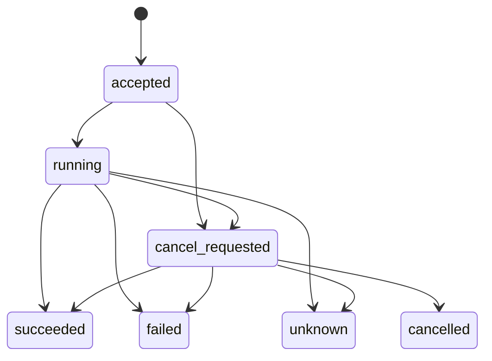

# SCP-Lab 设备访问协议 v0.1

[English](../device-access.md) · [文档目录](README.md) · [首页](../../README.zh-CN.md) · [应用与 Agent 接入](clients.md) · [设备接入](backends.md) · [JSON Schema](../../schemas/README.zh-CN.md)

本文说明 v0.1 的请求、响应、字段含义，以及本仓库运行时处理请求的规则，供应用调用和后端开发时查阅。当前服务通过本地 MCP stdio 接受调用；调用方负责实验规划和多步骤编排。

连接与调用步骤见[应用接入指南](clients.md)，设备配置、能力定义和 SDK 接入步骤见[后端指南](backends.md)。

## 标识与能力

调用方先发现设备实例，再查询该实例提供的能力。以下标识分别说明设备型号、具体实例、执行实现和可请求的操作：

| 字段 | 含义 |
| --- | --- |
| `model_id` | 设备型号 |
| `device_id` | 本地配置的设备实例，提交请求时用它选择设备 |
| `backend_id` | 执行该实例请求的后端实现 |
| `capability_id` | 该实例提供的一项能力，提交请求时用它选择操作 |

同一型号的实例可以使用不同后端，提供不同能力。调用前通过 `describe_device(device_id)` 读取实际实例的描述。

返回的每项能力包含 `capability_id`、`version`、`description`、`input_schema`、`result_schema` 和 `completion_criteria`。其中，两个 schema 分别说明输入和成功结果的格式，`completion_criteria` 说明完成条件。能力 schema 使用 JSON Schema Draft 2020-12。

实例的 `execution_mode` 表示当前采用的执行方式，可以是离线校验、mock、官方仿真或真机执行，不要求逐级接入。调用方通过 `device_id` 选择实例，使用该实例声明的执行方式。不同执行方式的输入、结果格式和完成条件可以不同，应以查询到的能力定义为准。各方式的含义见[后端指南](backends.md#validation-and-execution-stages)，结果的解释见[完成依据](#completion-evidence)。

能力还可以通过 `access_level` 声明向调用方开放的控制范围，具体见[五个访问级别](design.md#五个访问级别)。内置设备功能主要属于 L3；OT-2 的 `delay` 辅助操作未声明访问级别。级别按发布的接口判断，多设备客户端示例的调用顺序和后端内部生成的指令均不改变能力声明的级别。

<a id="三个核心对象"></a>
## 设备描述、状态与执行记录

| 数据 | 通过哪个工具获取 | 主要内容 |
| --- | --- | --- |
| `DeviceDescriptor` | `describe_device` | 设备标识、提供方、执行方式、能力及版本、输入与结果 schema、可选状态 schema、是否支持取消 |
| `DeviceState` | `get_device_state` | 后端可用性、本地占用、关联任务，以及带时间和来源的可选观测 |
| `ExecutionRecord` | `submit_execution`、`get_execution`、`cancel_execution` | 一次请求及其生效参数、版本、执行状态、进度、结果、错误和完成依据 |

`list_devices` 返回设备描述的摘要，并在每项的 `state` 中附带状态快照。因此，列表中的 `item.state.state` 对应单独查询时的 `DeviceState.state`。

设备专属字段分别由 `input_schema`、`result_schema` 和 `state_schema` 定义。后端按实际支持的操作和可报告的数据声明这些字段；没有温度、转速或样品位置观测时，可以省略相应观测。

### 描述版本

`descriptor_revision` 是对设备静态描述、能力 schema、版本和已声明配置版本计算的 SHA-256 内容标识。可用性或占用变化不会改变它。本仓库运行时在启动时固定描述，修改能力声明或静态配置后需要重启服务。

后端可以通过 `configuration_version` 声明配置版本；凭据保留在本地配置中。每次执行记录实际使用的 `descriptor_revision` 和 `capability_version`，便于核对请求依据的接口。

请求可携带 `expected_descriptor_revision`。若与当前描述不匹配，服务在执行前返回 `descriptor_changed`，调用方应重新查询描述；省略时使用当前版本。该版本用于核对接口定义，设备校准和就绪情况需通过设备反馈确认。

### 可选字段

| 所属数据 | 字段 | 默认值或省略时的含义 |
| --- | --- | --- |
| 设备描述 | `provider`、`configuration_version` | `null`：未声明 |
| 设备描述 | `state_schema` | `null`：未声明观测值的 schema |
| 设备描述 | `cancellation_supported` | `false`：未声明支持取消 |
| 能力 | `access_level` | `null`：未声明访问级别 |
| 能力 | `defaults_policy` | `not_applied`：不自动填充 schema 默认值 |
| 能力 | `result_schema` | `{"type":"object"}`；后端可声明更具体的成功结果格式 |
| 能力 | `limitations` | 空列表：未列出限制；接入方仍需说明已知限制 |
| 设备状态 | `observation` | `null`：当前没有可用观测 |
| 执行记录 | `progress`、`result` | 尚未填充时为空对象 |

设备和能力标识、输入 schema 及执行方式需要明确。各能力 schema 的 `required` 列表决定哪些实验参数必填，操作范围和默认值也由该能力声明。

## MCP 工具与消息

| 工具 | 输入 | 成功响应的 `data` |
| --- | --- | --- |
| `list_devices` | 可选 `device_class` | 实例摘要及嵌套状态快照 |
| `describe_device` | `device_id` | `DeviceDescriptor` |
| `get_device_state` | `device_id` | `DeviceState` |
| `submit_execution` | `request` | 已接受的执行记录，包含 `run_id` |
| `get_execution` | `run_id` | 该执行的最新记录 |
| `cancel_execution` | `run_id` | 请求取消后的执行记录 |

### 响应格式

通用设备工具在 MCP 的 `structuredContent` 和等价 JSON 文本中返回响应，并通过 `outputSchema` 声明格式：

| 情况 | MCP 的 `isError` | 响应内容 |
| --- | --- | --- |
| 工具调用成功 | `false` | `{"ok":true,"data":...}` |
| 工具调用被拒绝 | `true` | `{"ok":false,"error":{"code":...,"message":...,"details":{...}}}` |
| 成功查询到失败或结果不确定的任务 | `false` | `ok=true`，任务状态和错误保存在 `data.status`、`data.error` 中 |

因此，调用 `get_execution` 后，还需要读取任务的 `status` 判断执行结果。错误代码及其出现位置见[错误与 schema](#错误与-schema)。

MCP 参数结构错误或未预期的服务错误可能由 MCP SDK 直接生成，响应格式可能不同于上表。[应用接入示例](clients.md)中的 `call()` 辅助函数在成功时提取 `data`，在工具调用出错时抛出异常。

### 请求格式与示例

`submit_execution` 接受一个 `request`，必填字段为 `device_id`、`capability_id` 和 `arguments`。可选的 `expected_descriptor_revision` 用于核对描述版本，`idempotency_key` 用于[重试同一次请求](#幂等性与会话范围)。

`arguments` 是所选能力的 `input_schema` 描述的完整对象。字段名称、层次、必填项和是否允许额外字段均由该 schema 决定。输入使用标准 JSON；NaN 和 Infinity 会被拒绝。

以下以离心机离线校验实例为例，展示完整的工具参数。本例的能力使用 `parameters` 保存操作参数，使用 `bindings` 保存样品引用：

```json
{
  "request": {
    "device_id": "agilent_centrifuge_773-validation",
    "capability_id": "agilent_centrifuge_773.centrifugation",
    "arguments": {
      "parameters": {
        "speed": 1000,
        "duration": 30,
        "acceleration_percent": 100,
        "deceleration_percent": 100
      },
      "bindings": {"sample": {"resource_id": "sample-plate"}}
    },
    "idempotency_key": "my-centrifugation-1"
  }
}
```

该能力规定速度单位为 rpm、时间单位为秒。`bindings.sample.resource_id` 是调用方与本地后端约定的样品引用。离线后端检查引用结构；接入真机时，应结合本地设备和样品配置核实资源及位置。引用是否包含 `position`、`sample_id` 或使用数组，也由目标能力的 schema 决定。

其他能力可以采用不同的参数结构。例如，`ot2-sim` 使用 `setup + liquids + parameters`，[酶标仪适配器示例](backends.md#develop-an-adapter-for-a-new-sdk-or-api)使用 `plate_id + wavelength_nm`。

<a id="units-and-defaults"></a>
## 单位与默认值

### 固定单位

后端在数值字段的 schema 中使用 `x-scp-unit` 声明单位，输入、结果和状态观测采用同样约定。例如，某个对象的 `properties` 中可以包含：

```json
{
  "volume": {
    "type": "number",
    "exclusiveMinimum": 0,
    "maximum": 1000,
    "x-scp-unit": "uL"
  }
}
```

调用时提交 `{"volume":50}`，表示 50 uL；边界和默认值也使用该单位。只有能力 schema 明确接受时，才可以传入 `"50 uL"` 或 `{"value":50,"unit":"uL"}`。数组应在数值 `items` 的 schema 上标注单位。

`x-scp-unit` 说明数值的单位，JSON Schema 校验器按声明的类型和约束检查数值，不自动换算。项目常用的单位记法包括 `uL`、`mL`、`L`、`s`、`min`、`degC`、`nm`、`mm`、`rpm`、`%`、`ppm` 和 `mbar`；酶标仪示例用 `AU` 表示吸光度。设备也可以采用另行说明的单位。

缺少单位注解表示未声明单位，不表示无量纲。调用方应从目标能力的 schema 确认单位；接入方应补充所用字段的单位说明。计数可通过字段名称和说明表达，需要显式声明无量纲时可以使用 `1`。部分内置振荡参数和焦点高度字段的单位尚未声明，使用这些字段前需核对其约定。

### 多种单位

支持多单位的设备可以定义 `{"volume":{"value":0.05,"unit":"mL"}}` 这样的输入，并在 schema 中声明允许的单位及相应边界。必要的换算由该后端实现。转速与相对离心力的换算还需要设备几何参数，接入时应一并考虑。

### 参数默认值

能力的 `defaults_policy` 说明 schema 中的 `default` 如何处理：

| 策略 | 处理方式 | 内置示例 |
| --- | --- | --- |
| `not_applied` | 默认策略，按提交内容传递参数；`default` 仅作说明 | 离线校验实例 |
| `backend_resolved` | 后端通过 `resolve_arguments()` 填充已发布的可选默认值，再次校验生效参数 | 演示加热器和 OT-2 后端 |

两种策略下，`required` 中的字段都需要显式提供；声明 `default` 不会使必填字段变成可选字段。

以[应用接入指南](clients.md)中的演示加热器为例，省略可选的 `duration_s` 时，后端填入一秒。执行记录节选：

```json
{
  "request": {"arguments": {"target_celsius": 37}},
  "effective_arguments": {"target_celsius": 37, "duration_s": 1}
}
```

`request.arguments` 保留原始输入，`effective_arguments` 保存实际传给 `execute()` 的参数。实际温度等设备反馈应通过结果或观测报告，与请求设置分开。

<a id="动态状态与来源"></a>
## 设备状态与观测

`DeviceState.state` 描述设备实例在当前服务中的可用性和占用情况；`ExecutionRecord.status` 描述一次任务的执行情况。

| 设备的 `state` | 含义 |
| --- | --- |
| `idle` | 后端可用，当前没有未释放的任务占用 |
| `busy` | 有任务已接受或正在执行，包括等待取消确认 |
| `unavailable` | 当前没有任务占用，但后端不可用 |
| `needs_attention` | 任务已有最终状态，但占用尚未释放，需要核实处理 |

`available` 单独报告后端可用性。基础后端默认返回 `true`，表示软件实现可用；真机是否就绪需要结合设备反馈确认。`reported_at` 是本次状态快照的生成时间，`source="local_execution_runtime"` 和 `scope="this_server_process"` 表明状态由当前服务进程记录。

后端可以在 `observation` 中提供设备观测：

| 字段 | 含义 |
| --- | --- |
| `values` | 由设备的 `state_schema` 定义的观测值 |
| `observed_at` | 原始观测时间，再次查询缓存时保留此时间 |
| `source` | 数据来源，例如设备 SDK 或仿真器 |
| `kind` | 数据种类：`measured`、`device_reported`、`simulated` 或 `declared` |

发布观测需要声明 `state_schema`，运行时按它校验 `values`。没有可用观测时返回 `observation=null`。请求设置和实际读数应使用含义明确的不同字段。

状态查询只读取可用性和缓存观测。设备占用在请求接受时建立，执行所需的条件仍需在请求检查和执行时核实。

## 执行生命周期与占用

提交请求后，运行时先检查请求和本地可用性，通过后接受任务并占用实例。每个实例最多有一个未释放的任务；冲突返回 `device_busy`，不排队。不同实例可以并发执行。

任务状态按下图变化：



`accepted` 表示请求已通过检查并登记，调用方使用返回的 `run_id` 查询后续状态。`succeeded` 表示本次调用成功，具体完成了什么由执行方式、结果和[完成依据](#completion-evidence)共同说明。成功结果会按 `result_schema` 校验。

### 取消执行

设备描述声明 `cancellation_supported=true` 时，可以请求取消。进入 `cancel_requested` 后仍需继续查询，后端确认操作已停止后才返回 `cancelled`；如果操作同时完成，也可能返回 `succeeded`。最终还可能是 `failed` 或 `unknown`，应按实际状态处理。

当前 OT-2 仿真实现不支持取消。中断服务进程不能证明真机已经停止，应通过设备反馈核实。

### 结果不确定与设备释放

后端无法确认执行结果时返回 `unknown`；真机后端未处理的异常也归为 `unknown`。此时设备保持 `needs_attention`，运行时不自动重试。

任务结束后，后端通过 `BackendResult.device_released` 说明设备是否可以解除本次占用：

- 真机后端确认设备可以接收下一项操作后，显式返回 `device_released=true`。成功、失败或取消的任务都需要单独确认释放。
- 软件后端在结果明确的最终状态下默认释放，也可以显式保留占用。
- `unknown` 始终保留占用。最终执行记录保存实际的 `device_released`。

当前运行时没有手工清除未释放占用的接口。真机接入时，应在控制软件或后端中提供核实和恢复方法。

执行状态或进度变化时更新 `updated_at`，单纯查询不会改变它。`finished_at` 记录本地执行协程结束的时间，物理操作是否停止仍需设备反馈确认。

<a id="completion-evidence"></a>
## 完成依据

能力的 `completion_criteria` 声明什么情况下算完成，执行记录的 `completion_evidence` 保存本次调用提供的依据。结合 `execution_mode` 和该能力的 `result_schema` 读取结果：

| `execution_mode` | `completion_evidence.kind` 示例 | 成功的含义 |
| --- | --- | --- |
| `schema_validation` | `schema_validation` | 请求通过已发布的输入 schema 校验 |
| `mock` | `mock_trace` | 演示软件流程完成 |
| `official_simulation` | `official_simulator_runlog` | 官方软件仿真完成 |
| `hardware` | 例如 `device_observation` | 实际反馈支持能力声明的完成条件 |

表中前三种 `kind` 来自内置后端，真机行是实现示例；自定义后端应说明所用依据的含义。后端、结果格式和完成条件应保持一致，详细依据可放在 `completion_evidence.details` 中。

`physical_execution=true` 标识真机执行路径。后端只有在实际反馈充分支持完成判断时，才能设置 `completion_evidence.physical_completion_verified=true`；运行时拒绝非真机后端作出这一声明。所有内置后端均在软件中运行。

<a id="幂等性与会话范围"></a>
## 重复提交与服务运行范围

提交请求时可以提供 `idempotency_key`，用于在未收到响应等情况下重试同一次请求。该键在同一个服务进程的同一 `device_id` 下生效：

| 提交方式 | 处理结果 |
| --- | --- |
| 使用原键重试相同请求 | 返回已有任务及其 `run_id` |
| 使用原键提交不同请求 | 返回 `idempotency_conflict` |
| 使用新键，或不提供键 | 按新请求处理，仍需通过参数和占用检查 |

比较请求时忽略对象键顺序，其余按 JSON 值比较。单位换算后相等的数值也不视为相同请求；重试时应保留原始请求内容。

任务记录、占用和去重记录保存在当前服务的内存中。提交和查询应保持同一个 MCP 会话。服务退出或重启后，旧的 `run_id` 无法继续查询，旧键也无法防止重复执行。多个独立启动的服务各自记录占用，因此同一台真实设备应由一个服务统一控制。决定重新执行前，先核实设备和实验的实际状态。

当前版本没有持久队列、断线恢复、跨进程锁、事件流或全局样品台账，需要这些功能时由接入方实现。OT-2 专用工具另行保存的仿真 JSON 文件不属于通用任务记录。

## 错误与 schema

工具调用被拒绝时，错误位于响应的 `error`；任务接受后发生的错误，位于执行记录的 `error`。两者都包含 `code`、`message` 和 `details`。

| 错误代码 | 常见原因 | 出现位置 |
| --- | --- | --- |
| `unknown_device`、`unknown_capability` | 指定设备未登记，或该设备未提供所选能力 | 工具响应 |
| `invalid_arguments` | 请求参数不符合能力要求 | 工具响应 |
| `backend_unavailable`、`device_busy` | 后端不可用，或实例仍有未释放的任务占用 | 工具响应 |
| `descriptor_changed` | 请求指定的描述版本与当前版本不同 | 工具响应 |
| `idempotency_conflict` | 同一个键已用于不同请求 | 工具响应 |
| `unknown_run` | 当前服务中没有该任务记录 | 工具响应 |
| `cancellation_unsupported` | 后端未声明支持取消活跃任务 | 工具响应 |
| `invalid_backend_state`、`invalid_backend_defaults` | 后端返回的状态或默认参数处理不符合声明 | 工具响应 |
| `backend_error`、`simulation_failed`、`execution_interrupted` | 后端异常、仿真失败或本地执行中断 | 执行记录 |

后端可以增加有文档说明的错误代码。公开消息 schema 及对应的 MCP 资源路径见 [JSON Schema 目录](../../schemas/README.zh-CN.md)。

### OT-2 专用工具

[OT-2 专用辅助工具](ot2-examples.md#ot-2-specific-tools)直接返回校验数据、代码或仿真记录，使用各自的数据格式，不采用通用设备工具的 `ok/data` 外层结构。

这些调用不经过 `submit_execution`，不占用设备实例，也不产生可供 `get_execution` 查询的通用执行记录。`simulate_protocol` 在仿真结束后返回，其 `run_id` 用于通过 `read_simulation_run` 读取保存的仿真记录。

<a id="轻量符合性检查"></a>
## 格式检查

完成[基础安装](installation.md)后，在仓库根目录运行：

```bash
uv run --no-sync scp-lab check
```

使用自有设备目录时，加上 `--devices-dir ./lab-devices`。命令读取已登记的设备描述和状态，检查数据结构、标识、JSON Schema、单位注解格式，以及观测值是否符合 `state_schema`。输出包含各实例的检查结果和已声明限制。

检查通过时，输出节选：

```json
{
  "status": "passed",
  "execution_performed": false
}
```

这表示描述和状态格式检查通过，尚未执行设备操作。可选仿真器不可用不属于格式错误；后端的 `read_state()` 应只返回可用性和缓存观测。

接入时还应核对单位及参数范围，并通过实际调用验证参数处理、返回结果、完成依据和已支持的取消流程，使能力定义与后端行为保持一致。具体步骤见[真机接入说明](backends.md#4-接入真实设备)。
